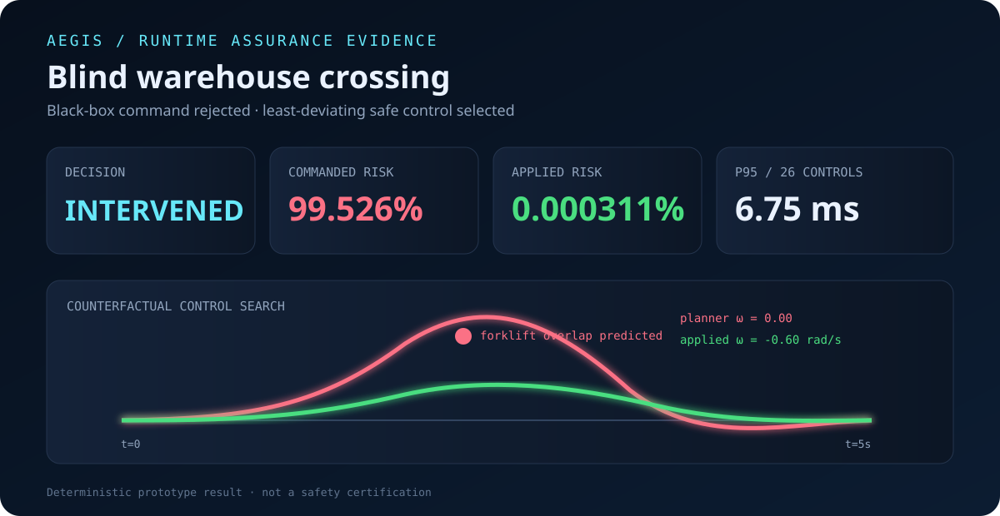
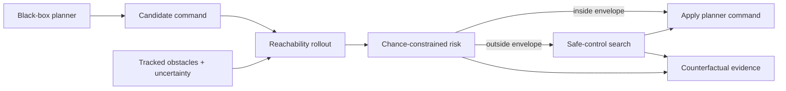

# Aegis Runtime Assurance

[](https://github.com/Parth-Oza/aegis-runtime-assurance/actions/workflows/ci.yml)
[](LICENSE)

[Live technical brief](https://parth-oza.github.io/aegis-runtime-assurance/) · [Decision evidence](https://parth-oza.github.io/aegis-runtime-assurance/demo/evidence.html)

Aegis is a deterministic safety supervisor for mobile robots. It sits between any upstream planner—classical, learned, or vendor-supplied—and the actuators. Before a command is applied, Aegis predicts a probabilistic reachable tube, measures collision risk under perception and motion uncertainty, and replaces unsafe commands with the least-deviating safe alternative.

The output is not just **stop/go**. Every decision produces machine-readable JSON and a standalone evidence report showing the predicted hazard, the intervention, and the counterfactual risk reduction.



## Why this problem matters

Robotics teams routinely integrate black-box autonomy components that perform well in nominal simulation but fail at rare interaction boundaries. Re-training the planner is slow; proving the full stack safe is harder. Runtime assurance provides a separable, testable safety boundary while preserving planner performance whenever the command stays inside the safety envelope.

## What is implemented

- Bounded unicycle rollout with explicit reaction latency
- Dynamic-obstacle prediction with time-growing motion uncertainty
- Optional non-Gaussian calibration from recorded trajectory residuals
- ROS 2 `Twist` command guard, tracked-object adapter, and timestamped diagnostics
- Chance-constrained collision risk and worst-tail risk scoring
- Simplex-style command supervision around an arbitrary planner
- Deterministic search for the least-deviating safe control
- Optional discrete control-barrier-function fallback with explicit feasibility status
- Counterfactual explanation of risk before and after intervention
- JSON decision evidence and a portable HTML report
- Repeatable latency benchmark and dependency-free Python core

## Quick start

```bash
python3 -m venv .venv
source .venv/bin/activate
python -m pip install -e . pytest
python -m aegis_rt run scenarios/warehouse_crossing.json --output artifacts
python -m aegis_rt benchmark scenarios/warehouse_crossing.json --runs 1000
pytest -q
```

Open `artifacts/evidence.html` after the run. The included crossing scenario places an autonomous mobile robot and an uncertain forklift on a collision course; the upstream command is evaluated, rejected, and replaced with a lower-risk control.

## Reproduced reference result

Measured locally on 2026-09-06 using Python 3.14.7 on arm64:

| Signal | Result |
|---|---:|
| Commanded collision risk | 99.5260% |
| Applied collision risk | 0.000311% |
| Minimum applied clearance | 1.39 m |
| Controls evaluated | 26 |
| Median supervisor latency | 6.4947 ms |
| p95 supervisor latency | 6.7506 ms |
| Automated tests | 7 passed |

The benchmark used 50 warm-up evaluations followed by 1,000 recorded evaluations. These are prototype measurements on one machine, not a real-time guarantee or safety certification.

The benchmark reports latency, feasibility, and normalized command deviation separately for the `lattice` and `cbf` fallback controllers. Select one with `--controller lattice` or `--controller cbf`; the default compares both.

For tracker-specific uncertainty, fit a deterministic empirical artifact with `aegis-rt calibrate` and compare its risk estimates to the radial Gaussian baseline with `aegis-rt compare-predictors`. The compact data format, coverage metrics, and provenance requirements are documented in [the calibration guide](docs/UNCERTAINTY_CALIBRATION.md). The checked-in residual dataset is explicitly synthetic and is not presented as field evidence.

The [`aegis_rt_ros`](ros2/aegis_rt_ros) package wraps the same supervisor as a fail-closed ROS 2 command guard. It accepts `Odometry`, `Twist`, and `Detection3DArray`, publishes an applied `Twist` plus timestamped diagnostics, and has a real `rosbag2_py` replay test. Build, parameters, topic remapping, and stale-stream behavior are documented in [the ROS 2 guide](docs/ROS2_COMMAND_GUARD.md).

## What demonstrates engineering depth

- **Separable safety architecture:** the upstream planner remains replaceable and untrusted.
- **Uncertainty is first-class:** the decision uses a time-growing motion envelope, not perfect future positions.
- **Fallback semantics are honest:** if no candidate meets the budget, the result is labeled minimum-risk rather than falsely safe.
- **Evidence is reproducible:** decision JSON, HTML, tests, and latency measurements come from the same deterministic core.
- **Deployment assumptions are explicit:** reaction delay, geometry, dynamics, and calibration gaps are documented for review.

## Architecture



See [docs/architecture.md](docs/architecture.md) for assumptions, safety boundaries, and extension points.

## Safety boundary

Aegis is a research prototype, not a certified safety component. The predictor deliberately exposes its assumptions. Real deployment requires hardware-specific braking validation, calibrated uncertainty, watchdogs, redundant sensing, and the safety process appropriate to the robot and operating domain.

## Contributing

The codebase is intentionally small enough to audit. Good next contributions include nonlinear obstacle models, ROS 2 message adapters, calibrated covariance propagation, control-barrier-function candidates, and property-based scenario generation. Read [CONTRIBUTING.md](CONTRIBUTING.md) before opening a pull request.

## Development record

The repository records its real implementation milestones in [docs/BUILD_LOG.md](docs/BUILD_LOG.md). It does not claim fabricated historical work or unsupported comparisons with other engineers.
